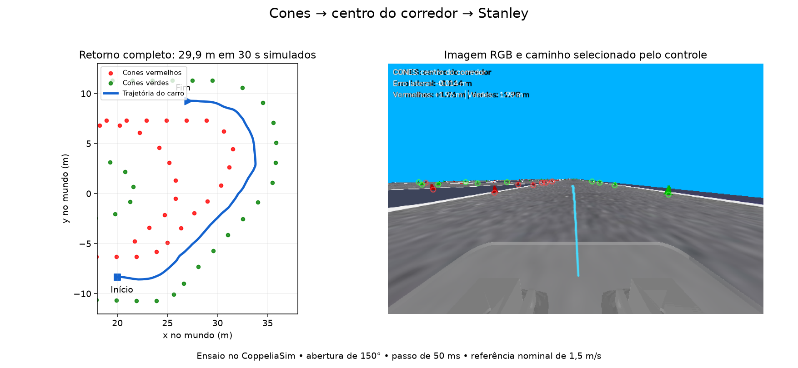

# Cones como referencia principal do Stanley

O controle do simulador escolhe uma unica referencia visual por passo:

1. **Cones vermelhos e verdes:** reconstrucao do centro do corredor.
2. **Linha amarela:** alternativa quando o corredor nao pode ser estimado com confianca.
3. **Sem referencia valida:** velocidade de referencia zero e frenagem pelo PI longitudinal.

As duas referencias alimentam o mesmo controlador Stanley. A troca de fonte conserva
o limite de velocidade do esterco, evitando um salto de comando. O veiculo real
continua com sua implementacao anterior.

## Executar

Abra no CoppeliaSim a cena `simulador/coppeliasim/simulador_cones_sem_linha.ttt`
e execute, a partir da raiz do repositorio:

```bash
venv/bin/python simulador/main.py --duration 240 --speed 1.5
```

A cena `simulador_cones.ttt` permite exercitar a alternativa da linha amarela.
O programa conecta ao CoppeliaSim ja aberto, prepara a simulacao e executa em passos
sincronizados. `--host`/`--port` selecionam a API (padrao `127.0.0.1:23000`); `--no-display` desliga
os graficos; `--no-real-time` remove a espera para acompanhar o relogio real.

As dependencias estao em `simulador/requirements.txt`.
A missao ajusta a abertura horizontal da camera virtual para 150 graus
(`vision_angle_deg`), para observar as duas bordas do corredor largo nas curvas.
O valor anterior do sensor e restaurado ao encerrar a missao; a cena nao e salva.

## Da imagem ao comando

A entrada e uma imagem **RGB** do sensor, corrigida verticalmente pelo `Car`.
A segmentacao por cor identifica regioes vermelhas e verdes e encontra a base
visivel de cada cone. A base e mais adequada que o centro da mancha porque
corresponde aproximadamente ao contato com o chao.
Quando um cone vermelho toca a pintura vermelha do meio-fio, a segmentacao
separa o corpo vertical da faixa de cor e recupera o contato na mascara original.

A perspectiva e a pose da camera convertem cada base de pixels para metros,
intersectando o raio visual com o plano da pista. O controle usa apenas essas
observacoes da camera: nao le o nome, o identificador ou a posicao dos objetos
cones da cena.

Os pontos das duas cores definem as bordas do corredor. A estimativa central
compara as bordas na mesma distancia longitudinal, em vez de juntar simplesmente
o cone vermelho mais proximo com o verde mais proximo. Isso permite que os cones
estejam desencontrados e que o corredor faca curvas. Uma memoria local limitada
preserva pontos ja vistos quando os cones proximos saem do campo da camera.
As observacoes repetidas sao associadas espacialmente por cor para manter um ponto
filtrado por cone. Um ajuste robusto separa as bordas dos cones de outros trechos
que aparecem ao fundo. Curvas com apoio suficiente tambem podem ser modeladas como
arcos concentricos, cujo raio central fica entre os raios das duas bordas.

Os ajustes ficam no dicionario `parameters` passado a `run_mission`:

| Parametro | Padrao | Funcao |
| --- | --- | --- |
| `cone_max_distance` | 12 m | Alcance longitudinal usado no corredor |
| `cone_memory_horizon` | 6 s | Idade maxima dos pontos de apoio ja vistos |
| `cone_freshness` | 0,5 s | Tempo maximo sem deteccao nova de cada cor |
| `cone_single_side_timeout` | 12 s | Validade da largura aprendida para oclusao de uma borda |
| `cone_min_span` | 1 m | Comprimento minimo de apoio por borda |
| `cone_max_near_distance` | 6 m | Distancia maxima do apoio mais proximo |
| `cone_min_width` / `cone_max_width` | 0,75 / 7 m | Intervalo de largura aceitavel |
| `cone_ground_z` | 0,005 m | Altura do plano de contato no mundo |

Para iniciar a estimativa da largura, e necessario apoio de pelo menos dois cones de cada cor, comprimento e
sobreposicao longitudinal suficientes e bordas sem cruzamento. A estimativa
curva requer mais apoio que uma reta. A memoria conserva a geometria proxima,
e exige deteccoes recentes. Se uma borda ficar oculta, o controle pode continuar
com pelo menos tres pontos consistentes da borda visivel e a largura previamente
observada nas duas cores, durante no maximo 12 s sem renovar essa largura. Uma
unica cor nunca inicializa o corredor. Se o apoio ou o prazo acabarem, a referencia
e rejeitada e a hierarquia procura a linha amarela.

O caminho central fornece tres medidas no eixo dianteiro:

- `cross_track_m`: distancia lateral assinada ate a trajetoria; positiva a esquerda.
- `heading_error_rad`: diferenca entre a tangente da trajetoria e a direcao do carro.
- `curvature_m_inv`: curvatura local; positiva em curvas para a esquerda.

O Stanley calcula o esterco geometrico:

```text
esterco = erro_angular + atan2(ganho * erro_lateral, |velocidade| + suavizacao)
```

O comando respeita o limite de 20 graus e o limite de variacao por segundo. O
adaptador inverte o sinal para as juntas da cena, cuja convencao positiva vira
para a direita. A referencia longitudinal diminui com a curvatura e com os erros
de seguimento. O PI existente controla a velocidade resultante.

Quando ambas as referencias sao perdidas, o carro freia. Durante no maximo 0,4 s,
o esterco anterior pode ser mantido enquanto ele desacelera; isso evita desfazer
uma curva no meio da frenagem.

## Visualizacao e registro

A imagem mostra as bases detectadas, o caminho central e a fonte selecionada.
As distancias vermelha e verde sao laterais assinadas em metros, relativas ao
eixo dianteiro: esquerda positiva e direita negativa. A igualdade de seus modulos
indica centralizacao em um trecho aproximadamente reto.
Durante uma oclusao, a distancia da borda ausente e **estimada pela largura aprendida**;
essa condicao aparece na imagem e na coluna `cone_inferred_side`.

Os graficos mostram os erros do caminho selecionado, a velocidade de referencia,
a velocidade medida e o esterco. O CSV `logs/<experimento>/car.csv` inclui:

| Coluna | Significado |
| --- | --- |
| `path_source` | 2 = cones; 1 = linha amarela; 0 = sem referencia |
| `path_valid` | Validade da referencia efetivamente utilizada |
| `cones_valid` | Validade do corredor reconstruido |
| `cone_inferred_side` | 0 = duas bordas; 1 = vermelha estimada; 2 = verde estimada |
| `line_valid` | Linha amarela selecionada e valida |
| `yellow_evaluated` | Segmentacao amarela executada neste passo |
| `red_cones`, `green_cones` | Quantidade de bases detectadas na imagem atual |
| `red_lateral_m`, `green_lateral_m` | Distancia lateral de cada borda |
| `cross_track_m`, `heading_error_rad` | Erros enviados ao Stanley |
| `curvature_m_inv` | Curvatura da trajetoria selecionada |

`line_valid=0` com `yellow_evaluated=0` significa que os cones tiveram prioridade;
nao significa que a faixa amarela desapareceu.

## Limites da estimativa

A medida monocular supoe pista plana e a calibracao da camera do simulador.
Objetos coloridos parecidos com cones e corredores muito ocluidos exigem os filtros
de consistencia geometrica; uma deteccao isolada nao basta para liberar o seguimento.
Os pontos antigos expiram: a memoria nao permite navegar indefinidamente sem visao.

Para executar as verificacoes automaticas:

```bash
MPLBACKEND=Agg venv/bin/python -m unittest discover -s simulador/tests -v
```

## Validacao em 3 de novembro de 2026

As verificacoes automaticas incluem segmentacao, contato com o meio-fio,
associacao temporal, rejeicao de outros ramos, prioridade, troca de referencia,
oclusao e expiracao da largura, frenagem e exportacao de CSV. Os testes em malha
fechada tambem percorrem curvas completas para esquerda e direita com modelo
bicicleta, incluindo uma cadeia que renderiza imagens antes de detectar os cones.

Foram realizados estes ensaios na instancia isolada do CoppeliaSim, sem salvar
alteracoes nas cenas originais:

| Ensaio | Condicoes | Resultado |
| --- | --- | --- |
| Retorno pelos cones, sem linha | 30 s, passo de 50 ms, abertura 150 graus, velocidade nominal 1,5 m/s | 29,9 m percorridos; mudanca de orientacao de aproximadamente 177 graus |
| Fonte utilizada no retorno | 600 amostras controladas | 580 com cones; 20 sem referencia; 17 usaram largura aprendida durante oclusao |
| Erro visual no retorno | Amostras validas | Media absoluta de 0,18 m; pico de 1,81 m, incluindo transitorios e estimativas ruidosas |
| Afastamento dos cones no retorno | Medicao da cena apenas para avaliacao | Distancia minima de 1,79 m entre o centro do carro e o centro dos cones |
| Alternativa amarela | Cena com linha, cones ocultos para o teste, passo padrao de 10 ms | 301 de 301 amostras usando a linha; 2,79 m percorridos em 3 s |

O erro visual e a estimativa que o controlador recebe, nao uma medida independente
do erro real em relacao a um mapa. As posicoes dos cones usadas para avaliar o
afastamento nao sao fornecidas a percepcao nem ao Stanley. O ensaio cobre um
retorno completo e um trecho com a alternativa amarela; nao certifica uma volta
completa em toda a pista.


